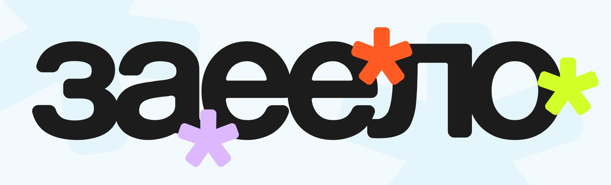

# ЗАЕЛО

Медиа о вредных привычках, которыми мы снимаем напряжение.



## Ссылки

[Сайт ↗](https://hseadc.github.io/zaelo/)

[Макет в Figma ↗](https://www.figma.com/design/QDPUKKMCt7KPXgdF4WI918/%D1%81%D1%82-1%D0%9C-%7C-%D0%BC%D0%B5%D0%B4%D0%B8%D0%B0-%D0%BF%D1%80%D0%BE%D0%B5%D0%BA%D1%82?node-id=8-20&t=v8Hbkqkmg8YeJJim-1)

## Скриншоты

- [Заглушка, десктоп](docs/images/home-desktop.png) <br>
- [Заглушка, мобильный](docs/images/home-mobile.png) <br>
- [О нас, десктоп](docs/images/about-us-desktop.png) <br>
- [О нас, мобильный](docs/images/about-us-mobile.png) <br>
- [Статья, десктоп](docs/images/article-desktop.png) <br>
- [Статья, мобильный](docs/images/article-mobile.png) <br>

## Команда

| Участник            | Что делал(а)                   |
| ------------------- | ------------------------------ |
| Мария Рачинская     | дизайн страниц и адаптивов |
| Ангелина Солдатенко | верстка страниц и адаптивов |
| Светлана Сенько     | анимации, подготовка статьи |


## Как запустить локально

```bash
git clone git@github.com:HSEADC/zaelo.git
cd zaelo
npm install
npm run dev
```

## Структура проекта

```
src/ — все файлы проекта: изображения, шрифты, код
    index.html - заглушка
    /fonts
    /images
    /javascripts
    /stylesheets
    /pages
        about.html - страница «о нас»
        habits.html
        mechanisms.html
        test.html
        /mechanisms
        /habits
            why-are-you-glued-to-the-phone.html - статья

docs/ — скриншоты, сборка проекта для GitHub Pages
```

## Решения и сложности

- Анимация рисования стрелочек.
- Сделано не везде, сложно оказалось.

## Использование ИИ

### Инструменты

| Инструмент и модель | Кто     | Для каких задач                                                                    | Уровень (0–4) |
| ------------------- | ------- | ---------------------------------------------------------------------------------- | ------------- |
| Deepseek        | Света | Анимация рисования стрелочек svg. Сложность возникла из-за пересения линий в svg | 3          |
| ChatGPT             | Лина | Поиск ошибок в ссылках на страницы | 1           |
| ChatGPT             | Лина | Порядок элементов в flex-контейнере | 1           |
| ChatGPT             | Лина | Помощь в объединении веток git | 2           |

### Журнал запросов

#### #1 · 24.10.2026 · Света

- **Инструмент:** Deepseek
- **Задача:** Анимация рисования стрелочки формата svg непрерывной линией
- **Запрос:** Посмотри, почему не срабатывает анимация рисования непрерывной линией svg и исправь css. Нужно чтобы анимация срабатывала при долистывании до элемента с классом question__arrow.
- **Что выдал ИИ:** Сама анимация написана корректно — проблема почти всегда в самом path. stroke-dashoffset крутится вхолостую: визуально ничего не происходит.
- **Исправленный код:**
```
<svg
    class="question__arrow is-hidden"
    width="116"
    height="119"
    viewBox="0 0 116 119"
    fill="none"
>

    <mask id="arrow-mask">
        <path
            id="arrow-mask-body"
            d="M 0.3 117.5
            C 20.2 110.25 30 91 32 76"
            fill="none"
            stroke="white"
            stroke-width="5"
            stroke-linecap="round"
            stroke-linejoin="round"
            pathLength="1"
        />

        <path
            id="arrow-mask-loop-right"
            d="M 32 76
            C 31 75 31 72 31 66
            C 31 60 28 55 24 55"
            fill="none"
            stroke="white"
            stroke-width="5"
            stroke-linecap="round"
            stroke-linejoin="round"
            pathLength="1"
        />

        <path
            id="arrow-mask-loop-left"
            d="M 24 55
            C 20 55 17 58 18 63
            C 19 69 26 73 32 76"
            fill="none"
            stroke="white"
            stroke-width="5"
            stroke-linecap="round"
            stroke-linejoin="round"
            pathLength="1"
        />

        <path
            id="arrow-mask-tail"
            d="M 32 76
            C 50 88 80 88 98 76
            C 111 65 115 52 115.7 38
            C 114.4 24.7 109.9 11.1 106.7 0.6"
            fill="none"
            stroke="white"
            stroke-width="5"
            stroke-linecap="round"
            stroke-linejoin="round"
            pathLength="1"
        />

        <path
            id="arrow-mask-barb1"
            d="M 106.7 0.6 L 101.5 9.5"
            fill="none"
            stroke="white"
            stroke-width="5"
            stroke-linecap="round"
            pathLength="1"
        />

        <path
            id="arrow-mask-barb2"
            d="M 106.7 0.6 L 114 5"
            fill="none"
            stroke="white"
            stroke-width="5"
            stroke-linecap="round"
            pathLength="1"
        />
    </mask>

    <path
        id="questionArrow"
        d="M97.8606 75.2868L97.2582 74.4886V74.4886L97.8606 75.2868ZM23.2844 55.5925L23.1097 54.6079V54.6079L23.2844 55.5925ZM97.8606 75.2868L98.4629 76.0851C111.856 65.9777 115.958 52.0972 115.688 38.2871C115.418 24.5145 110.805 10.7368 106.696 0.623816L105.769 1.00024L104.843 1.37667C108.925 11.424 113.426 24.927 113.688 38.3263C113.95 51.6881 110.003 64.8707 97.2582 74.4886L97.8606 75.2868ZM97.8606 75.2868L97.2582 74.4886C74.5413 91.6326 48.1667 85.026 32.6041 74.9883L32.0621 75.8286L31.5201 76.669C47.4826 86.9647 74.8268 93.9228 98.4629 76.0851L97.8606 75.2868ZM32.0621 75.8286L32.6041 74.9883C26.3269 70.9395 21.9603 66.4246 20.2911 62.8446C19.4551 61.0518 19.3758 59.6756 19.8105 58.7232C20.2302 57.8038 21.2777 56.9643 23.4592 56.5771L23.2844 55.5925L23.1097 54.6079C20.5856 55.0559 18.791 56.1402 17.9911 57.8927C17.2063 59.6121 17.53 61.6556 18.4784 63.6898C20.378 67.7639 25.1059 72.5319 31.5201 76.669L32.0621 75.8286ZM23.2844 55.5925L23.4592 56.5771C24.9862 56.3061 26.2512 56.6117 27.304 57.3485C28.3807 58.1019 29.3072 59.3586 30.0148 61.098C31.4345 64.5882 31.8667 69.7686 31.071 75.6956L32.0621 75.8286L33.0532 75.9617C33.8747 69.8432 33.4666 64.2759 31.8674 60.3444C31.0655 58.373 29.9378 56.7505 28.4507 55.7098C26.9397 54.6525 25.1312 54.2491 23.1097 54.6079L23.2844 55.5925ZM32.0621 75.8286L31.071 75.6956C29.0664 90.626 19.3948 109.507 5.69224e-06 116.535L0.340698 117.475L0.681391 118.415C20.9949 111.054 30.9848 91.3679 33.0532 75.9617L32.0621 75.8286ZM106.158 0.0789733C105.65 -0.135822 105.063 0.102519 104.848 0.611322L101.348 8.90276C101.133 9.41156 101.371 9.99816 101.88 10.213C102.389 10.4277 102.976 10.1894 103.19 9.6806L106.302 2.31044L113.672 5.42181C114.181 5.63661 114.767 5.39826 114.982 4.88946C115.197 4.38066 114.959 3.79406 114.45 3.57927L106.158 0.0789733Z"
        fill="black"
        mask="url(#arrow-mask)"
    />
</svg>

.question\_\_arrow {
    width: 114px;
    position: absolute;
    top: -70px;
    left: 105%;
    opacity: 1;
    transition: opacity 0.01s 0.1s;
}

#arrow-mask-body,
#arrow-mask-loop-right,
#arrow-mask-loop-left,
#arrow-mask-tail,
#arrow-mask-barb1,
#arrow-mask-barb2 {
    stroke-dasharray: 1;
    stroke-dashoffset: 1;
}

.question**arrow.is-hidden #arrow-mask-body,
.question**arrow.is-hidden #arrow-mask-loop-right,
.question**arrow.is-hidden #arrow-mask-loop-left,
.question**arrow.is-hidden #arrow-mask-tail,
.question**arrow.is-hidden #arrow-mask-barb1,
.question**arrow.is-hidden #arrow-mask-barb2 {
    animation-play-state: paused;
}

#arrow-mask-body {
    animation: draw 0.18s ease-in forwards;
}

#arrow-mask-loop-right {
    animation: draw 0.056s linear forwards;
    animation-delay: 0.18s;
}

#arrow-mask-loop-left {
    animation: draw 0.056s linear forwards;
    animation-delay: 0.236s;
}

#arrow-mask-tail {
    animation: draw 0.22s ease-out forwards;
    animation-delay: 0.292s;
}

#arrow-mask-barb1,
#arrow-mask-barb2 {
    animation: draw 0.048s linear forwards;
    animation-delay: 0.512s;
}

@keyframes draw {
    from {
        stroke-dashoffset: 1.02;
    }

    to {
        stroke-dashoffset: 0;
    }

}

(function initQuestionArrow() {
const arrow = document.querySelector('.question**arrow');
const target = document.querySelector('.question**text');
if (!arrow || !target) return;

if (!('IntersectionObserver' in window)) {
    arrow.classList.remove('is-hidden');
    return;
}

const io = new IntersectionObserver(
    (entries) => {
        for (const e of entries) {
            if (e.isIntersecting) {
                arrow.classList.remove('is-hidden');
                io.disconnect();
                return;
            }
        }
    },
    {
    threshold: 0.4,
    rootMargin: '0px 0px -20% 0px',
    }
);

io.observe(target);
})();
```

- **Что изменили и почему:** Дописал класс is-hidden, переписал svg файл с использованием масок, написал скрипт, чтобы отрабатывало только при долистывании до нужного элемента на странице.
- **Итог и проверка:** animation.js, index.html, layout.css, animation.css

### Рефлексия
**Света**<br>
Отлично решил задачу. Быстро разобрался в причине. 

**Лина**<br>
ИИ помог разобраться с различием особенностей оформления ссылок для локального просмотра и проекта на GitHub Pages. Подсказал команды терминала для правильной последовательности слияния веток и решения конфликтов. От ИИ узнала css-свойство `order` во flex-контейнере.
