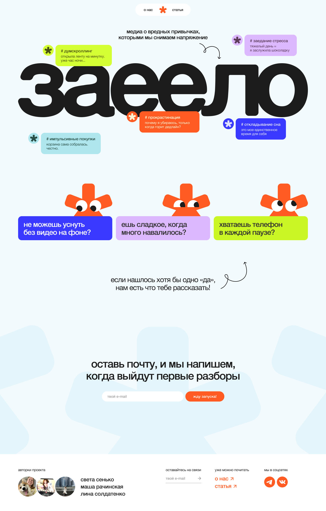
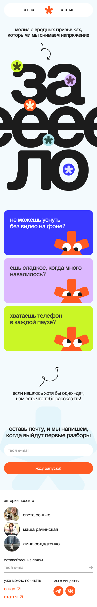

# [Название проекта]

[Одна фраза: что это за сайт и для кого.]

## Ссылки

- Сайт: [https://username.github.io/project]
- Макет в Figma: [ссылка на просмотр]

## Скриншоты

 

## Команда

| Участник | Что делал(а)                   |
| -------- | ------------------------------ |
| [Имя]    | [страницы, компоненты, задачи] |
| [Имя]    | [страницы, компоненты, задачи] |

## Стек

- [Инструмент и версия]
- [Инструмент и версия]

## Как запустить локально

```bash
git clone [адрес репозитория]
cd [папка проекта]
npm install
npm run dev
```

## Структура проекта

```
src/        — [пояснение]
public/     — [пояснение]
docs/       — скриншоты и журнал ИИ
```

## Решения и сложности

- [Что было сложно и как решили]
- [Что сознательно не сделали и почему]

## Использование ИИ

### Инструменты

| Инструмент и модель | Кто | Для каких задач | Уровень (0–4) |
| ------------------- | --- | --------------- | ------------- |
| [ ]                 | [ ] | [ ]             | [ ]           |

### Журнал запросов

[Записи по формату ниже или ссылка: подробный журнал — в docs/ai-log.md]

#### #1 · [дата] · [автор]

- **Инструмент:** [ ]
- **Задача:** [ ]
- **Запрос:** [ ]
- **Что выдал ИИ:** [ ]
- **Что изменили и почему:** [ ]
- **Итог и проверка:** [файл, коммит, как проверили]

### Рефлексия

[5–10 предложений: где ИИ помог, где ошибался, что не взяли в проект, чему научились, что сделали бы иначе.]